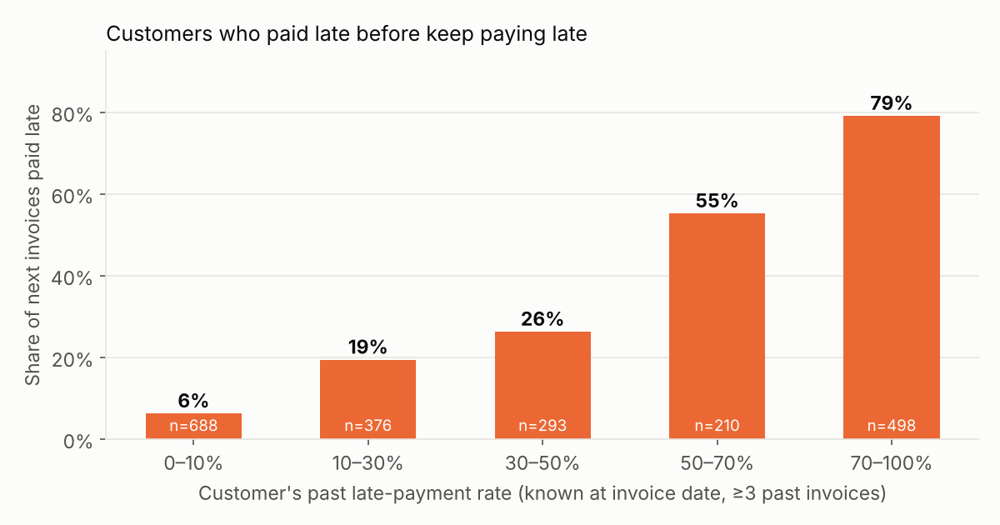
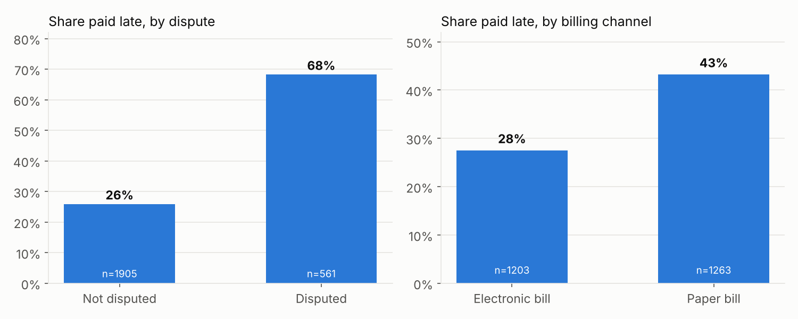
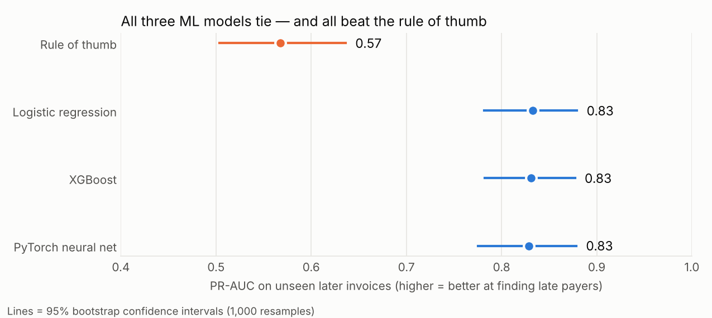

# CashFlow AI — Collections Intelligence System

Predicts which customer invoices will be paid late, automates prioritised
follow-ups (with human approval for high-value accounts), and forecasts
incoming cash.

**Stack:** Python · pandas · PyTorch · XGBoost · FastAPI · Docker · n8n · LLM API

> Status: 🚧 Step 2 of 4 complete (models + prediction API)

## Headline results (on unseen, later invoices)

| What | Result |
|---|---|
| Finds late payers (ROC-AUC) | **0.92** vs 0.81 for a rule of thumb |
| Calling only the riskiest 20% of invoices reaches | **57% of all late invoices** (max possible: 70%) |
| Predicts *when* cash arrives | within **4.8 days** on average, vs 11.1 days assuming "pays on due date" |
| Weekly cash-forecast error (21-week backtest) | **23%** vs 36% for the due-date rule → **35% less error** |

## The business problem

Sales are made, but cash sits in receivables. Collections teams chase every
customer the same way, learn too late who won't pay, and can't tell the CFO
how much cash is coming next month. For a company with AED 50M annual
revenue, each extra day of DSO ties up roughly AED 137k of cash.

## Data

[IBM Accounts Receivable sample dataset](https://github.com/pthiagu2/DataMining/blob/master/WA_Fn-UseC_-Accounts-Receivable.csv)
— 2,466 invoices, 100 customers, 5 countries, Jan 2012 – Dec 2013,
30-day payment terms.

## Step 1 findings (exploratory analysis)

| Finding | Number |
|---|---|
| Invoices paid late | 35.6% |
| Late rate when the invoice is **disputed** vs not | 68% vs 26% |
| Late rate for **paper** vs electronic bills | 43% vs 28% |
| Customers with a bad track record (70–100% past late rate) who pay the next invoice late | 79% (vs 6% for reliable customers) |
| Median delay of a late invoice | 8 days (90th percentile: 20 days) |
| Share of all late-days caused by the 10 worst customers | 37% |




**Business takeaways**
1. A customer's own payment history is the strongest early-warning signal —
   collections should be risk-based, not one-size-fits-all.
2. Resolving disputes fast is a collections lever: disputed invoices are
   2.6× more likely to be late.
3. Moving customers to e-invoicing is associated with fewer late payments
   (correlation, not proven cause).

## Step 2: models — an honest comparison

Time-based split: trained on 1,851 invoices (Jan 2012 – Jun 2013), tested on
615 later invoices (Jun – Dec 2013). A random split would let the model
"see the future".

| Model | ROC-AUC | PR-AUC | Brier (lower = better) | Late invoices caught in top 20% |
|---|---|---|---|---|
| Rule: past late rate > 50% | 0.805 | 0.567 | 0.185 | 41% |
| **Logistic regression** | **0.925** | **0.833** | **0.099** | 57% |
| XGBoost | 0.923 | 0.831 | 0.101 | 57% |
| PyTorch neural network | 0.922 | 0.829 | 0.101 | 59% |



**Decision:** the three ML models are statistically tied (bootstrap 95%
intervals overlap almost completely). I deploy **logistic regression as the
champion** because it is equally accurate, simpler, cheaper to run, and every
prediction can be explained to a finance team or auditor. The **PyTorch
model runs as a challenger** in the API, scored side by side, so it can
replace the champion if it pulls ahead as more data arrives.

**Top risk drivers:** customer's past late rate, how late past payments
were, whether the invoice is disputed, billing channel.

## Prediction API (FastAPI)

| Endpoint | What it returns |
|---|---|
| `GET /health` | service status |
| `POST /score` | risk for one invoice: probability late, expected delay, risk tier, recommended action, human-approval flag, plain-English reasons |
| `GET /portfolio/open-invoices?as_of=2013-09-15` | every open invoice ranked by **cash at risk** (probability × amount), with the next action |
| `GET /portfolio/cash-forecast?as_of=2013-09-15` | expected collections per week vs the due-date rule (and actuals, since this is a backtest) |

Example `/score` response:
```json
{
  "probability_late": 0.786,
  "challenger_probability_late": 0.932,
  "risk_tier": "HIGH",
  "recommended_action": "Firm reminder now + phone call from account manager",
  "needs_human_approval": false,
  "reasons": ["invoice is under dispute", "receives paper (not electronic) bills", "frequently disputes invoices"]
}
```

**Controls built in:** HIGH-risk invoices above the 90th-percentile amount
are flagged `needs_human_approval` — the automation must not send a firm
message to a key account without a person signing it off.

## Design decisions (and why)

- **No data leakage.** A customer's history features only use invoices that
  were already *settled* before the new invoice was issued — exactly what a
  real collections team would know on that day.
- **New customers** with no history get the portfolio-average late rate
  known at that time.
- **Dispute flag:** in practice a dispute is raised after the invoice is
  sent, so the system re-scores open invoices daily as disputes come in.
- **Known data limitation:** the dataset only contains invoices that were
  eventually settled. Invoices issued near the end of 2013 are therefore
  biased towards fast payers (visible as falling days-to-settle in late 2013).
  Model evaluation will account for this.

## Project structure

```
data/raw/            original dataset
data/processed/      engineered features
src/features.py      leakage-safe feature engineering
src/eda.py           analysis + charts
src/train.py         model training & comparison
src/backtest_forecast.py  cash-forecast backtest
models/              trained models
reports/             charts, metrics, test predictions
api/app.py           FastAPI prediction service
Dockerfile           container for deployment
render.yaml          one-click Render deployment
requirements.txt     API runtime (no PyTorch)
requirements-train.txt  training & analysis (adds PyTorch)
n8n/                 collections workflow export  (step 3)
docs/                architecture, demo           (step 4)
```

## Run it

```bash
pip install -r requirements-train.txt
python src/features.py            # build features
python src/eda.py                 # analysis + charts
python src/train.py               # train & compare models
python src/compare_chart.py       # comparison chart with confidence intervals
python src/backtest_forecast.py   # cash-forecast backtest
uvicorn api.app:app --port 8000   # start API → open http://localhost:8000/docs
```

Or with Docker: `docker build -t cashflow-ai . && docker run -p 8000:8000 cashflow-ai`

## Deployment

Deployed on **Render** (free tier) straight from this repo via `render.yaml`.
The PyTorch challenger is trained with PyTorch, then its weights are exported
to numpy (`models/pytorch_mlp_weights.npz`) and served with a 5-line numpy
forward pass, so the API doesn't need the 700MB+ PyTorch library at runtime.
Verified identical to PyTorch output (max difference < 0.0000002).

## Roadmap

- [x] Step 1 — Data, leakage-safe features, exploratory analysis
- [x] Step 2 — Rule of thumb vs logistic regression vs XGBoost vs PyTorch; honest comparison; FastAPI service; cash-forecast backtest
- [ ] Step 3 — n8n collections autopilot with human-approval step
- [ ] Step 4 — Cash forecast, dashboard, demo video
